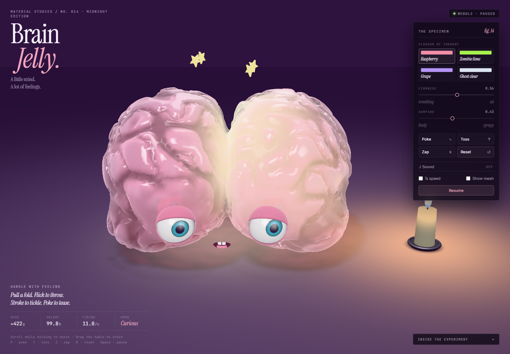
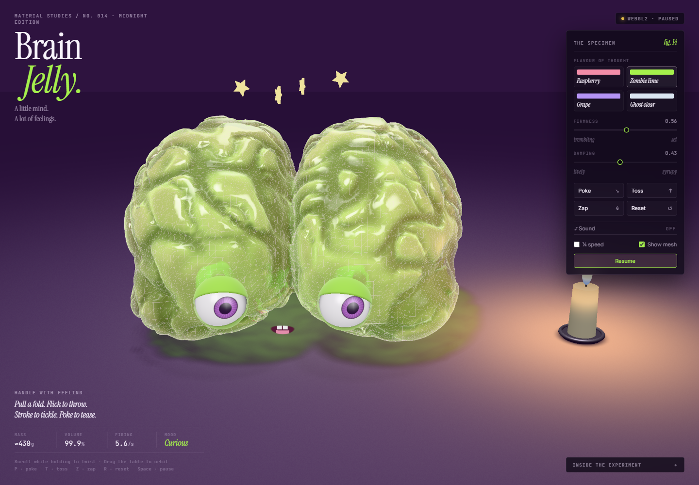

# Jelly Brain 3D

**A little mind. A lot of feelings.**

Tarik lipatannya, lempar ke udara, lalu lihat reaksinya. Jelly Brain 3D adalah playground fisika di browser: sebuah otak jelly dengan permukaan berkilau, mata ekspresif, dan respons terhadap sentuhan. Eksperimen ini tampil dengan judul **Brain Jelly · Material Studies No. 014, Midnight Edition**.

**[Main sekarang di GitHub Pages](https://aldoprawiroa.github.io/Jelly-Brain-3D/)** · [Unduh rilis v1.0.0](https://github.com/aldoprawiroa/Jelly-Brain-3D/releases/tag/v1.0.0) · [Laporkan masalah](https://github.com/aldoprawiroa/Jelly-Brain-3D/issues)



## Main dalam satu menit

1. Buka **[Jelly Brain 3D](https://aldoprawiroa.github.io/Jelly-Brain-3D/)** melalui browser dengan WebGL dan akselerasi perangkat keras aktif. Koneksi internet diperlukan untuk Three.js dan font.
2. Tunggu proses **Synthesising Brain Jelly** selesai. Geometri dan simulasi dibuat saat halaman dibuka.
3. Klik dan tarik permukaan otak untuk meregangkannya. Lepaskan dengan gerakan cepat untuk melemparnya.
4. Coba **Poke**, **Toss**, dan **Zap**, lalu pilih warna di **Flavour of Thought**.
5. Aktifkan **Sound** bila ingin efek suara. Tekan **R** atau **Reset** untuk mengembalikan spesimen.

Ini adalah sandbox untuk bereksperimen, tanpa skor, level, atau kondisi menang. Desktop dengan mouse memberi akses paling lengkap ke gestur dan pintasan.

## Kontrol

| Kontrol | Fungsi |
| --- | --- |
| Klik/tahan dan tarik otak | Pegang dan regangkan bagian permukaan |
| Lepas setelah menarik cepat | Lempar jelly dengan momentum gerakan |
| Usap permukaan | Gelitik dan amati perubahan ekspresinya |
| Scroll sambil memegang | Putar bagian yang sedang dipegang |
| Scroll tanpa memegang | Dekatkan atau jauhkan kamera |
| Tarik area meja/latar | Orbit kamera mengelilingi spesimen |
| **P** / **Poke** | Beri impuls tusukan |
| **T** / **Toss** | Lempar spesimen ke udara |
| **Z** / **Zap** | Picu reaksi listrik dan aktivitas saraf |
| **R** / **Reset** | Kembalikan spesimen setelah bereksperimen |
| **Space** / **Pause**, **Resume** | Jeda atau lanjutkan simulasi |
| **Sound** | Nyalakan atau matikan suara prosedural; awalnya OFF |
| **¼ speed** | Perlambat simulasi untuk mengamati deformasi |
| **Show mesh** | Tampilkan wireframe permukaan |
| **Inside the experiment** | Buka penjelasan teknik simulasi dan rendering |

Pintasan keyboard tidak diproses saat fokus berada pada input, termasuk slider. Klik area kosong untuk kembali memakai pintasan. Pada layar sentuh, gunakan panel tombol untuk aksi utama; scroll saat memegang memerlukan mouse/trackpad.

## Atur karakter jelly

| Pengaturan | Pilihan / rentang | Efek |
| --- | --- | --- |
| Flavour of Thought | Raspberry, Zombie lime, Grape, Ghost clear | Mengubah warna, karakter material, dan tampilan spesimen |
| Firmness | 0.15–0.95; awal 0.55 | Dari mudah bergetar ke lebih kokoh |
| Damping | 0.05–0.90; awal 0.42 | Dari gerakan hidup ke gerakan yang lebih teredam |

Coba firmness rendah dengan **Toss**, lalu aktifkan **¼ speed** dan **Show mesh** untuk melihat lipatan berubah. Bandingkan dengan firmness tinggi. Biarkan spesimen tanpa interaksi untuk melihatnya mengantuk dan tertidur.



Screenshot di atas diambil dari aplikasi yang berjalan di browser, bukan ilustrasi. Tampilan dan kelancaran bergantung pada GPU, ukuran layar, dan keadaan simulasi.

## Apa yang ada di dalamnya?

- **Geometri prosedural:** bentuk otak dibangun dari signed distance field (SDF), lipatan berbasis noise, dan Surface Nets.
- **Fisika soft body:** lattice tetrahedral body-centered cubic (BCC), solver co-rotational XPBD, dan penjagaan volume menggerakkan deformasi.
- **Material jelly:** pipeline beberapa pass menggabungkan ketebalan, refraksi screen-space, absorpsi Beer–Lambert, bayangan berwarna, dan ambient occlusion.
- **Karakter ekspresif:** mata, pupil, kelopak, mulut, serta mood bereaksi terhadap gerakan dan interaksi.
- **Detail interior:** jaringan saraf bercahaya, gelembung, dan pencahayaan lilin melengkapi spesimen.
- **Audio prosedural:** efek suara disintesis dengan Web Audio API setelah pengguna mengaktifkan suara.
- **Telemetry:** panel menampilkan massa preset, persentase volume, firing rate, dan mood. Angka ini merupakan bagian dari simulasi visual, bukan pengukuran medis.

## Menjalankan secara lokal

Tidak ada langkah build, instalasi paket, akun, atau backend. HTML, CSS, shader, dan JavaScript aplikasi berada di `index.html`.

```bash
git clone https://github.com/aldoprawiroa/Jelly-Brain-3D.git
cd Jelly-Brain-3D
python -m http.server 8000
```

Buka **http://localhost:8000**. Pada Windows dengan Python Launcher, gunakan `py -m http.server 8000` jika `python` tidak tersedia. Hentikan server dengan **Ctrl+C**. Alternatifnya, gunakan server statis dari editor Anda.

Server lokal tidak membuat aplikasi sepenuhnya offline: Three.js r128 dimuat dari cdnjs, sedangkan Instrument Serif, Inter, dan JetBrains Mono dimuat dari Google Fonts.

## GitHub Pages

Repositori ini disajikan sebagai situs statis dari branch **`main`**, direktori **`/` (root)**. Berkas `.nojekyll` menonaktifkan pemrosesan Jekyll; tidak diperlukan workflow atau build tambahan.

Untuk menerapkan ulang atau menyiapkan fork:

1. Push berkas proyek ke repositori GitHub Anda.
2. Buka **Settings → Pages**.
3. Di **Build and deployment**, pilih **Deploy from a branch**.
4. Pilih **main**, folder **/ (root)**, lalu **Save**.
5. Tunggu deployment selesai; gunakan URL yang ditampilkan GitHub. Untuk fork, sesuaikan tautan demo di README dengan pemilik dan nama repositori Anda.

Deployment dapat memerlukan beberapa menit setelah push. Periksa bagian **Actions** dan **Settings → Pages** jika perubahan belum muncul.

## Struktur proyek

```text
.
├── index.html                     # Seluruh aplikasi, fisika, rendering, dan UI
├── README.md                      # Panduan bermain dan pengembangan
├── CHANGELOG.md                   # Catatan rilis
├── docs/screenshots/              # Screenshot gameplay asli
├── .gitignore                     # Mengabaikan cache dan artefak lokal
└── .nojekyll                      # Penyajian statis GitHub Pages
```

## Pemecahan masalah

| Gejala | Yang dapat dicoba |
| --- | --- |
| Loading lama pada pembukaan pertama | Tunggu pembentukan mesh dan lattice; tutup tab berat atau gunakan perangkat dengan GPU lebih kuat |
| Layar kosong / WebGL tidak tersedia | Aktifkan hardware acceleration, periksa dukungan WebGL, lalu muat ulang |
| `THREE is not defined` / pustaka tidak termuat | Periksa koneksi dan apakah cdnjs diblokir oleh ekstensi atau jaringan |
| Gerakan tersendat | Kecilkan jendela browser, matikan Show mesh, dan tutup aplikasi berat; ¼ speed memperlambat waktu simulasi, bukan jaminan peningkatan FPS |
| Tidak ada suara | Klik Sound sampai ON, periksa volume perangkat dan apakah tab dibisukan |
| Spesimen terlempar jauh atau sulit dijangkau | Tekan R atau klik Reset |
| Pages menampilkan 404 | Pastikan main/root sudah dipilih dan deployment selesai; gunakan kapitalisasi URL yang benar |

Rendering dan fisika cukup berat; pengalaman pada ponsel atau GPU lama dapat berbeda. Kontrol gestur lengkap dan seluruh kombinasi perangkat/browser belum diuji. Versi ini memerlukan koneksi ke layanan CDN dan belum menyediakan mode offline.

## Kontribusi dan kredit

Temukan bug? Sertakan langkah reproduksi, browser/versi, perangkat/GPU jika tersedia, serta screenshot atau pesan console dalam [issue](https://github.com/aldoprawiroa/Jelly-Brain-3D/issues). Untuk perubahan, buat branch dan pull request dengan penjelasan perilaku sebelum/sesudah serta cara memeriksanya.

Dikelola oleh [aldoprawiroa](https://github.com/aldoprawiroa). Rendering menggunakan [Three.js](https://github.com/mrdoob/three.js/tree/r128) (MIT); font disediakan oleh [Google Fonts](https://fonts.google.com/). Lisensi dependensi tetap mengikuti ketentuan masing-masing. Repositori ini belum menetapkan lisensi untuk kode aplikasinya; akses publik tidak otomatis memberikan izin redistribusi atau penggunaan ulang.
